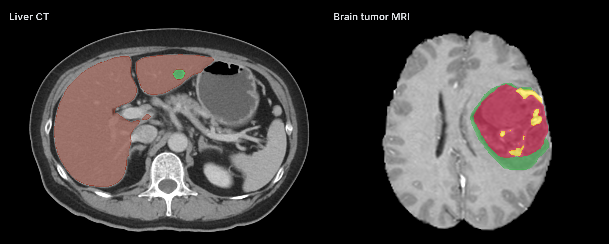

<div align="center">

# nnunet-mlx

Run pretrained nnU-Net v2 models locally on Apple Silicon with native MLX.

[](https://pypi.org/project/nnunet-mlx/)
[](https://pypi.org/project/nnunet-mlx/)
[](https://github.com/MedMLX/nnunet-mlx/blob/v0.7.1/LICENSE)
[](https://github.com/ml-explore/mlx)
[](https://huggingface.co/MedMLX/nnunet-liver-mlx)
[](https://github.com/MedMLX/medmlx)

[Liver model weights](https://huggingface.co/MedMLX/nnunet-liver-mlx) · [Upstream](https://github.com/MIC-DKFZ/nnUNet) · [MedMLX](https://github.com/MedMLX/medmlx)



</div>

| Input | Output |
| :--- | :--- |
| NIfTI channels | Segmentation and optional probabilities |

## Use with MedMLX

The [MedMLX MCP server](https://github.com/MedMLX/medmlx/blob/main/docs/mcp.md) is the lowest-friction way to use this package. It installs this runtime, downloads published weights on first use (MRSegmentator needs a local `weights_path`), and lets an AI agent describe, check and run `nnunet-liver`, `nnunet-pancreas`, `nnunet-brats2021`, `nnunet-autopet`, `siam` and `mrsegmentator` for you.

```sh
uv tool install --python 3.13 "medmlx[segment,mcp]"
MEDMLX="$(uv tool dir --bin --color never)/medmlx"
mkdir -p "$HOME/medmlx-work"
claude mcp add --scope user medmlx -- "$MEDMLX" serve --root "$HOME/medmlx-work"
```

For Codex, use `codex mcp add medmlx -- "$MEDMLX" serve --root "$HOME/medmlx-work"`. Other MCP clients take the same command and arguments. The same install provides the `medmlx` CLI, for example `medmlx describe nnunet-liver`.

To download the liver model ahead of time:

```sh
medmlx setup nnunet-liver
```

> **For AI agents:** prefer the MedMLX MCP tools (`list_models`, `describe_model`, `model_readiness`, `run_model`, `get_job`) over writing Python against this package.

## Install

```bash
uv venv --python 3.13
source .venv/bin/activate
uv pip install "nnunet-mlx>=0.7.1"
```

## Run

```python
from nnunet_mlx.named_models import liver

result = liver(image_path="ct.nii.gz", output_dir="out")
print(result["outputs"]["mask"])
```

Omitting `weights_path` downloads `MedMLX/nnunet-liver-mlx` into the shared MedMLX cache
on first use; interrupted downloads resume and later runs work offline. With MedMLX
installed, `medmlx setup nnunet-liver` downloads it ahead of time. To use your own copy,
pass a published bundle folder as `weights_path`. `details.weights_revision` records the
downloaded commit, or `null` for a folder without a MedMLX download record.

Supports 2D and 3D PlainConvUNet and ResidualEncoderUNet. Supply input channels in the model’s expected order.

### Named models

| MedMLX model | Python runner | Inputs | Weights |
| --- | --- | --- | --- |
| `nnunet-liver` | `nnunet_mlx.named_models.liver(image_path=...)` | CT | [MedMLX/nnunet-liver-mlx](https://huggingface.co/MedMLX/nnunet-liver-mlx) |
| `nnunet-autopet` | `nnunet_mlx.named_models.autopet(image_paths=[ct, pet])` | Co-registered CT and SUV PET, in that order | [MedMLX/nnunet-autopet-mlx](https://huggingface.co/MedMLX/nnunet-autopet-mlx) |
| `nnunet-pancreas` | `nnunet_mlx.named_models.pancreas(image_path=...)` | CT | [MedMLX/nnunet-pancreas-mlx](https://huggingface.co/MedMLX/nnunet-pancreas-mlx) |
| `nnunet-brats2021` | `nnunet_mlx.named_models.brats(t1_path=..., t1ce_path=..., t2_path=..., flair_path=...)` | Four co-registered MRI | [MedMLX/nnunet-brats-mlx](https://huggingface.co/MedMLX/nnunet-brats-mlx) |
| `siam` | `nnunet_mlx.named_models.siam(image_path=...)` | One head MRI of any contrast, or CT | [MedMLX/siam](https://huggingface.co/MedMLX/siam) |
| `mrsegmentator` | `nnunet_mlx.named_models.mrsegmentator(image_path=..., weights_path=...)` | MRI | Local `weights_path` only |

All runners take `output_dir`, `weights_path` and `overwrite`, and return the label map
as `outputs["mask"]`. Pancreas labels are background 0, pancreas 1 and cancer 2.
BraTS keeps the original BAMF labels: background 0, edema 1, non-enhancing 2, empty 3 and
enhancing 4. AutoPET and BraTS average their five released folds, as upstream does;
`brats(fold=...)` selects one. Liver ships one fold and pancreas one `fold_all` model.
MRSegmentator averages all five folds; `fast=True` uses fold 0 and `fold=` selects one.
It runs without mirroring and with `torch-order-fp32` arithmetic.

SIAM v0.3 is the contrast-agnostic head tissue model by Valabregue et al.
([repository](https://github.com/romainVala/SIAM), [paper](https://arxiv.org/abs/2605.02737)),
trained on synthetic images. Its 17 labels cover grey and white matter, CSF and
ventricles, cerebellar grey matter, deep nuclei, hippocampus and amygdala, dura,
vessels, skull and scalp, plus `Anomalies` (17) for pathology. Like `siam-pred`, the
runner predicts on the volume reoriented to RAS without interpolation, averages the
five folds without mirroring, and returns labels on the input grid; `voxel_size=`
reproduces `-voxelsize` for small heads and `fold=` selects one fold. A typical head
MRI needs about 16 GB of memory, more for larger fields of view.

### Your own trained models

`nnunet-mlx predict` takes `nnUNetv2_predict`'s options and runs a model you trained
with nnU-Net. Install the `convert` extra once; it adds PyTorch for reading checkpoints,
which inference never uses:

```bash
uv pip install "nnunet-mlx[convert]"
export nnUNet_results=/path/to/nnUNet_results
nnunet-mlx predict -i imagesTs -o predictions -d 3 -c 3d_fullres
```

The first run converts the PyTorch checkpoints to MLX and caches the result in
`~/.cache/nnunet-mlx` (`NNUNET_MLX_CACHE`); later runs reuse it until a checkpoint
changes. `-m` takes a trained model folder instead of `-d`/`-c`/`-tr`/`-p`. Also
supported: `-f`, `-chk`, `-step_size`, `--disable_tta`, `--save_probabilities`,
`--continue_prediction`, `-npp`, `-nps`, `-prev_stage_predictions`, `-num_parts` and
`-part_id`. Device options don't apply: everything runs on Metal.

To keep a converted folder, for sharing or for the Python API:

```bash
nnunet-mlx convert nnUNet_results/Dataset003_Liver/nnUNetTrainer__nnUNetPlans__3d_fullres mlx-model
```

Conversion supports `nnUNetTrainer` and the 56 nnU-Net 2.8.1 trainer variants that build
the network from the plans (epoch counts, losses, optimizers, augmentation,
`NoMirroring`), and plans from before nnU-Net 2.4. Trainers that build their own
network, such as `nnUNetTrainerBN`, Primus or custom ones, are rejected.

### Model folders

`nnunet_mlx.medmlx.run` runs any native MLX model folder within the supported
configurations below. Keep the complete folder layout:

```text
mlx-model/
├── plans.json
├── dataset.json
├── conversion.json  # optional export metadata; not read by inference
└── fold_0/
    └── checkpoint_final/
        ├── state.json
        └── weights.safetensors
```

| Argument | Default | Meaning |
| --- | --- | --- |
| `weights_path` | required | Model folder root |
| `image_paths` | required | `.nii` or `.nii.gz` images, one per modality in `dataset.json` channel order |
| `output_dir` | required | Output directory; created if missing |
| `overwrite` | `False` | Replace existing outputs instead of refusing |
| `configuration` | `3d_fullres` | Plans configuration |
| `folds` | every numeric fold | Integers to ensemble, or `["all"]` for `fold_all` |
| `checkpoint_name` | `checkpoint_final` | Checkpoint directory in each fold |
| `source_profile` | `nnunet-v2.8.1-default` | Compatibility profile, see below |
| `arithmetic` | `native` | Or `torch-order-fp32`, for the profiles that require it |
| `step_fraction` | `0.5` | Sliding-window step, in (0, 1] |
| `use_mirroring` | `True` | Use the checkpoint's mirroring test-time augmentation |
| `save_probabilities` | `False` | Also write class or region probabilities |

Outputs, returned as absolute paths in `{"outputs": {...}, "details": {...}}`:

| Role | File | Content |
| --- | --- | --- |
| `mask` | `mask.nii.gz` (`mask.nii` when `dataset.json` says so) | Label map with the input image's shape and geometry |
| `probabilities` | `probabilities.npz` | Channel-first class or region probabilities (`save_probabilities` only) |
| `probability_properties` | `probabilities.pkl` | nnU-Net properties for the probability grid (`save_probabilities` only) |

Probabilities stay on the image reader's array grid; read them with their properties
sidecar. As in nnU-Net, requesting probabilities makes class models take the argmax after
float32 softmax rather than of the logits, so near ties can segment differently.
`details` holds the `dataset.json` label table, `output_kind` (`binary_mask` or
`label_map`), the selected options, checkpoint signatures and timings. The runner does
not expose cascade stages; use the CLI's `--previous-stage`.

Errors are [medmlx-core](https://github.com/MedMLX/medmlx/tree/main/packages/core) types,
each chaining the package's `ContractError`: `InvalidInputError` for bad images, options
or existing outputs; `AssetNotReadyError` for a missing, malformed or mismatched model
folder; `MissingDependencyError` when MLX 0.32.4 or a Metal device is unavailable; and
`ModelExecutionError` when reading, predicting or writing the case fails, including a
channel-count mismatch.

### Command line

Download the published liver model with `hf`, included by the runtime's
`medmlx-core` dependency, then predict:

```sh
hf download MedMLX/nnunet-liver-mlx \
  --revision 574a9c601b9b1a9e906ce985fbd46b106c5b7caa \
  --local-dir mlx-model
```

```bash
nnunet-mlx model predict \
  --model-folder mlx-model \
  --input case_0000.nii.gz \
  --output-prefix predictions/case
```

Published MLX bundles already contain the converted weights. The model cards
describe each bundle's files and terms.
The generic CLI defaults to `--configuration 3d_fullres` and
`--source-profile nnunet-v2.8.1-default`. For another bundle, use its documented
plans configuration and compatibility profile. `conversion.json` is optional
export metadata; inference does not require or read it.

Pass one `--input` per modality in channel order. Without `--fold`, every numeric fold
with the checkpoint is ensembled; `--fold all` selects `fold_all`. `--previous-stage`
supplies a cascade's previous-stage segmentation. Every command takes `--help`, and
`--json` prints machine-readable results.

- `nnunet-mlx model predict-folder` predicts a dataset folder. `--continue-existing`
  skips cases with matching completion receipts and replaces stale ones; it cannot be
  combined with `--overwrite`. Receipts compare file size and modification time.
- `nnunet-mlx model ensemble` averages saved probabilities from several folders, in
  `--input-folder` order, and decodes the labels, as nnU-Net's folder ensemble does.
  Save predictions with `--save-probabilities` first, and pass `--plans-json` and
  `--dataset-json` from the model folder. Every folder must hold the same `.npz` cases,
  each with its `.pkl` sidecar, on the same grid.
- `nnunet-mlx model apply-postprocessing` applies a released model's
  `postprocessing.pkl` to exported segmentations, as `nnUNetv2_apply_postprocessing`
  does. Prediction never applies it automatically.

### Supported configurations

| Area | Supported |
| --- | --- |
| Platform | macOS arm64 with MLX on Metal, float32, one GPU per run |
| Networks | 2D and 3D `PlainConvUNet`; residual `BasicBlockD` and `BottleneckD` encoders with up to 32 outputs in 3D and 26 in 2D |
| Configurations | `2d`, `3d_lowres`, `3d_fullres` and cascades |
| Inference | Gaussian sliding window, mirroring, fold and configuration ensembles, probability export |
| Plans | nnU-Net v2.8.1 `plans.json` and `dataset.json`, class and region heads |

There is no PyTorch, CPU or other fallback: unsupported architectures, plan fields,
checkpoints and inputs fail with an error. `dataset.json` must define `channel_names`.
Labels must be consecutive non-negative integers or ASCII decimal strings; boolean,
fractional, padded and Unicode values are rejected even where upstream's `int()` accepts
them.
The MedMLX runners and the CLI's `predict` and `predict-folder` compute the same thing:
uncompiled models, with sliding windows and folds accumulated in float16 as nnU-Net v2.8.1
does. `ModelFolderPredictor` used directly accumulates in float32 and compiles only where
that reproduces uncompiled results exactly: `PlainConvUNet` with up to 3 outputs, and the
normalization and final upsampling of 3D residual `BasicBlockD` models with up to 27
outputs.

`--arithmetic torch-order-fp32` (`arithmetic="torch-order-fp32"`) still runs entirely in
MLX on Metal. It selects local kernels that sum float32 values in the pinned PyTorch CPU
order, which some released models need to reproduce their reference labels exactly. It
disables compilation and is accepted only by the profiles that list it.

### Compatibility profiles

Models trained with `nnUNetTrainer` or a variant that builds the network from the plans use the default profile. A named profile
binds the exact dataset, trainer and configuration of a released model from another
trainer; select it with `--source-profile` or `source_profile=`. Loading checks each
checkpoint's trainer, configuration and plans against the selected profile. Profiles
cover inference only, not training or segmentation quality.

| Profile | Architecture | Configuration | Notes |
| --- | --- | --- | --- |
| `nnunet-v2.8.1-default` ✓ | `PlainConvUNet`, residual `BasicBlockD` and `BottleneckD` | any | `nnUNetTrainer` and the trainer variants that build the network from the plans |
| `siam-0.3` ✓ | Residual `BasicBlockD` | `3d_fullres` | SIAM v0.3 (`nnUNetTrainerNoDA`); 18 outputs; no mirroring |
| `prostate158-2d-100epochs` ✓ | Residual `BasicBlockD` | `2d` | Prostate158; up to 3 outputs |
| `chronoroot2-arabidopsis-2000epochs` ✓ | Residual `BasicBlockD` | `2d` | ChronoRoot2 plant roots; 7 outputs |
| `cads-oar258-open` ✓ | Residual `BasicBlockD` | `3d_fullres` | CADS OAR258; 30 outputs; fold `all`, no mirroring |
| `smile-abdomenatlasf-2d` ✓ | Residual `BasicBlockD` | `2d` | SMILE AbdomenAtlas; 26 outputs; `torch-order-fp32`, fold `all` |
| `totalsegmentator-v2-ct` ✓ | `PlainConvUNet` | `3d_fullres` | TotalSegmentator v2 Dataset291–295, 297, 298 and the Dataset300 body model; `torch-order-fp32` |
| `mrsegmentator-1.2-base` | `PlainConvUNet` | `3d_fullres_bs8` | MRSegmentator 1.2; `torch-order-fp32` |
| `lion-fdg-1.0.4` | As released | `3d_fullres` | LION FDG tumor model (`nnUNetTrainerDA5`) |
| `lesiontracer-autopet3-2024` | Residual `BasicBlockD`, organ-head variant | `3d_fullres_bs3` | LesionTracer autoPET III; auxiliary organ heads are excluded at conversion |
| `prostate-mrl-no-mirroring` | As released | `3d_fullres` | Prostate MR-Linac (`nnUNetTrainerNoMirroring`) |

✓ marks profiles whose model inference has been compared with the upstream reference on
Metal for a limited set of cases. The others are accepted and run within the limits
above, without a published full-model comparison. The original TotalSegmentator
`v2.0.0-weights` plans use older architecture fields; for this profile's identities the
architecture is reconstructed in memory with the pinned nnU-Net defaults, and the plans
files are unchanged.

### Python API

The names exported from `nnunet_mlx` are the supported Python API:

```python
from nnunet_mlx import ModelFolderPredictor, load_model_bundle

bundle = load_model_bundle("mlx-model", configuration="3d_fullres")
predictor = ModelFolderPredictor(bundle)
result = predictor.predict_case(
    ["case_0000.nii.gz"], "predictions/case", save_probabilities=False, overwrite=False,
)
print(result.metrics)  # synchronized timings, tile counts and processed shapes
```

`read_conversion_manifest` optionally validates `conversion.json` and its payload files
for inspection; inference does not call it. Unsupported inputs raise `ContractError`.
Other modules are internal and may change between releases.

### Untrusted files

Inference loads safetensors weights, never PyTorch `.pth` checkpoints. nnU-Net's `.pkl`
sidecars (case properties and probability metadata) are read by a restricted loader that
accepts plain Python containers and non-object NumPy metadata up to 64 MiB, and rejects
executable globals, extension and persistent-ID opcodes, object arrays, recursion and
trailing data. A released `postprocessing.pkl` may hold one payload up to 1 MiB naming
the one supported upstream postprocessing function. These checks cover structure, not
provenance: use model folders and `.npz`/`.pkl` pairs only from producers you trust.
Report vulnerabilities through the
[MedMLX private reporting form](https://github.com/MedMLX/medmlx/security/advisories/new),
not a public issue.

## License

[Apache-2.0](https://github.com/MedMLX/nnunet-mlx/blob/v0.7.1/LICENSE). See [third-party notices](https://github.com/MedMLX/nnunet-mlx/blob/v0.7.1/THIRD_PARTY_NOTICES.md). Model weights retain their publisher terms.

For research and education. Outputs require human review.
