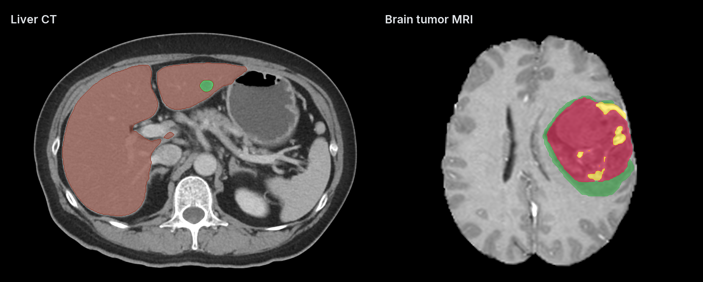

<div align="center">

# nnunet-mlx

Train and run nnU-Net models on Apple Silicon with native MLX.

[](https://pypi.org/project/nnunet-mlx/)
[](https://pypi.org/project/nnunet-mlx/)
[](https://github.com/MedMLX/nnunet-mlx/blob/v0.10.1/LICENSE)
[](https://github.com/ml-explore/mlx)
[](https://huggingface.co/MedMLX/nnunet-liver-mlx)
[](https://github.com/MedMLX/medmlx)

[Liver model weights](https://huggingface.co/MedMLX/nnunet-liver-mlx) · [Upstream](https://github.com/MIC-DKFZ/nnUNet) · [MedMLX](https://github.com/MedMLX/medmlx)



</div>

| Input | Output |
| :--- | :--- |
| NIfTI channels | Segmentation and optional probabilities |

| Model | Weights download | Peak MLX memory | Measured on |
| :--- | ---: | ---: | :--- |
| `nnunet-liver` | 125 MB | 5.5 GB | 768×768×101 abdominal CT |
| `nnunet-pancreas` | 410 MB | 14.5 GB | 768×768×101 abdominal CT |
| `nnunet-brats2021` | 628 MB | 7.4 GB | 240×240×155 four-sequence brain MRI |
| `nnunet-autopet` | 2.0 GB | 4.8 GB | 400×400×284 whole-body PET/CT |

## Install

```bash
uv venv --python 3.13
source .venv/bin/activate
uv pip install "nnunet-mlx>=0.10.1"
```

## Run

```python
from nnunet_mlx.named_models.liver import run

result = run(image_path="ct.nii.gz", output_dir="out")
print(result["outputs"]["mask"])
```

Without `weights_path`, `run` downloads `MedMLX/nnunet-liver-mlx` into the shared
MedMLX cache on first use; later runs work offline. `medmlx setup nnunet-liver`
downloads it ahead of time, and a model folder passed as `weights_path` uses your own
copy.

### Named models

Each released model is a module of `nnunet_mlx.named_models` with its own `run`:

| MedMLX model | Module | Inputs | Weights |
| --- | --- | --- | --- |
| `nnunet-liver` | `liver` | `image_path`: CT | [MedMLX/nnunet-liver-mlx](https://huggingface.co/MedMLX/nnunet-liver-mlx) |
| `nnunet-autopet` | `autopet` | `image_paths={"ct": ..., "pet": ...}`: co-registered CT and SUV PET | [MedMLX/nnunet-autopet-mlx](https://huggingface.co/MedMLX/nnunet-autopet-mlx) |
| `nnunet-pancreas` | `pancreas` | `image_path`: CT | [MedMLX/nnunet-pancreas-mlx](https://huggingface.co/MedMLX/nnunet-pancreas-mlx) |
| `nnunet-brats2021` | `brats` | `image_paths={"t1": ..., "t1ce": ..., "t2": ..., "flair": ...}`: co-registered MRI | [MedMLX/nnunet-brats-mlx](https://huggingface.co/MedMLX/nnunet-brats-mlx) |
| `siam` | `siam` | `image_path`: one head MRI of any contrast, or CT | [MedMLX/siam](https://huggingface.co/MedMLX/siam) |
| `mrsegmentator` | `mrsegmentator` | `image_path`: MRI | Local `weights_path` only |

Every `run` takes `output_dir`, `weights_path` and `overwrite`, and returns the label
map on the input grid as `outputs["mask"]`, with a `label_map` artifact listing its labels.
`nnunet_mlx.named_models.liver.load_model()` keeps the liver model loaded for several CTs:

```python
from nnunet_mlx.named_models.liver import load_model

with load_model() as model:
    for name in ("a", "b"):
        model.run(image_path=f"{name}.nii.gz", output_dir=f"out/{name}")
```

- **Liver** runs its one fold. Liver and AutoPET take `use_mirroring` and
  `step_fraction`: the released setting runs eight mirrored passes per tile at step
  0.5, and `use_mirroring=False` or a larger step does less work but changes the
  prediction.
- **Pancreas** runs one `fold_all` model. Labels: background 0, pancreas 1, cancer 2.
- **AutoPET** averages its five released folds, as upstream does.
- **BraTS** averages five folds; `fold=` selects one. It keeps the original BAMF labels:
  background 0, edema 1, non-enhancing 2, empty 3, enhancing 4.
- **MRSegmentator** averages five folds; `fast=True` uses fold 0 and `fold=` selects
  one. It runs without mirroring, with `source-fp32` precision.

**SIAM** v0.3 is the contrast-agnostic head tissue model by Valabregue et al.
([repository](https://github.com/romainVala/SIAM), [paper](https://arxiv.org/abs/2605.02737)),
trained on synthetic images.

- **Labels:** 17 labels cover gray and white matter, CSF and ventricles, cerebellar gray
  matter, deep nuclei, hippocampus and amygdala, dura, vessels, skull and scalp, plus
  `Anomalies` (17) for pathology.
- **Prediction:** like `siam-pred`, the runner predicts on the volume reoriented to RAS
  without interpolation, averages the five folds without mirroring, and returns labels
  on the input grid. `voxel_size=` reproduces `-voxelsize` for small heads and `fold=`
  selects one fold.
- **Memory:** a typical head MRI needs about 16 GB, more for larger fields of view.

### Train a model

Install this checkout with `uv pip install -e .`. Put split modalities in
`imagesTr/<case>_0000.nii.gz`, `imagesTr/<case>_0001.nii.gz`, and so on.
Put the matching label map in `labelsTr/<case>.nii.gz`. Declare the modalities,
labels, and file ending in `dataset.json`.

```bash
nnunet-mlx prepare-training Dataset001_Example prepared
nnunet-mlx train prepared mlx-model --epochs 100
nnunet-mlx model predict-folder --model-folder mlx-model \
  --input-folder Dataset001_Example/imagesTs --output-folder predictions
```

Preparation uses the training cases to set voxel spacing and U-Net patch
geometry, and fits foreground intensity statistics for channels named `CT`.
Use `--splits splits_final.json --fold 0` for a predefined split or
`--plans nnUNetPlans.json` for an existing single-stage plain or residual U-Net. Pass
`--configuration 2d` to prepare or predict with a 2-D network.
To train on all cases, pass `--fold all` at preparation and prediction.

`train` uses foreground-aware patch sampling and validates on whole held-out
cases. Class-based training uses Dice and class-weighted cross-entropy.
Overlapping regions use Dice and binary cross-entropy. `metrics.json` records
training loss and foreground Dice. Continue from the last completed epoch with
`nnunet-mlx train prepared mlx-model --resume --epochs 150`.
To start a new run from saved weights, pass
`--initialize-from mlx-model/fold_0/checkpoint_best`. Keep the checkpoint with its
model folder's `plans.json` and `dataset.json`. The prepared dataset must use the
same network topology and output label order.

`--precision bfloat16` and `--recompute` reduce training memory.
Use `--recompute-stages 2` to recompute the two highest-resolution stages in
each path. `--cosine-lr` adds warmup and cosine decay. `--focus-label 2`
prioritizes label 2 in foreground sampling. `--spatial-augment` replaces
mirroring with small in-plane rotations. Pass
`--checkpoint checkpoint_best` to predict with the best epoch from a run with validation.

### Convert a PyTorch-trained model

`nnunet-mlx predict` takes `nnUNetv2_predict`'s options and runs a model you trained
with nnU-Net. Install the `convert` extra once; it adds PyTorch for reading checkpoints,
which inference never uses:

```bash
uv pip install "nnunet-mlx[convert]"
export nnUNet_results=/path/to/nnUNet_results
nnunet-mlx predict -i imagesTs -o predictions -d 3 -c 3d_fullres
```

- **Caching:** the first run converts the PyTorch checkpoints to MLX and caches the
  result in `~/.cache/nnunet-mlx` (`NNUNET_MLX_CACHE`); later runs reuse it until a
  checkpoint changes.
- **Model selection:** `-m` takes a trained model folder instead of `-d`/`-c`/`-tr`/`-p`.
- **Other options:** `-f`, `-chk`, `-step_size`, `--disable_tta`, `--save_probabilities`,
  `--continue_prediction`, `-npp`, `-nps`, `-prev_stage_predictions`, `-num_parts` and
  `-part_id`.
- **Device options** don't apply: everything runs on Metal.

To keep a converted folder, for sharing or for the Python API:

```bash
nnunet-mlx convert nnUNet_results/Dataset003_Liver/nnUNetTrainer__nnUNetPlans__3d_fullres mlx-model
```

Conversion supports `nnUNetTrainer` and the 56 nnU-Net 2.8.1 trainer variants that build
the network from the plans (epoch counts, losses, optimizers, augmentation,
`NoMirroring`), and plans from before nnU-Net 2.4. Trainers that build their own
network, such as `nnUNetTrainerBN`, Primus or custom ones, are rejected.

### Other model folders

`nnunet_mlx.run(weights_path=..., image_paths=[...], output_dir=...)` runs any
converted MLX model folder within the supported configurations below, and
`nnunet_mlx.load_model(weights_path=..., ...)` loads one for several cases; its
`run` takes `image_paths`, `output_dir`, `overwrite` and `save_probabilities`.
Keep the complete layout:

```text
mlx-model/
├── plans.json
├── dataset.json
└── fold_0/
    └── checkpoint_final/
        ├── state.json
        └── weights.safetensors
```

| Argument | Default | Meaning |
| --- | --- | --- |
| `weights_path` | required | Model folder root |
| `image_paths` | required | `.nii` or `.nii.gz` images, one per channel in `dataset.json` channel-index order |
| `output_dir` | required | Output directory; created if missing |
| `overwrite` | `False` | Replace existing outputs instead of refusing |
| `configuration` | `3d_fullres` | Plans configuration |
| `folds` | every numeric fold | Integers to ensemble, or `["all"]` for `fold_all` |
| `checkpoint_name` | `checkpoint_final` | Checkpoint directory in each fold |
| `source_profile` | `nnunet-v2.8.1-default` | Compatibility profile, see below |
| `precision` | `fast-fp32` | Or `source-fp32`, for the profiles that require it |
| `step_fraction` | `0.5` | Sliding-window step, in (0, 1] |
| `use_mirroring` | `True` | Use the checkpoint's mirroring test-time augmentation |
| `save_probabilities` | `False` | Also write probabilities and their nnU-Net properties sidecar |

The result is `{"outputs": {...}, "artifacts": {...}, "details": {...}}`. `outputs["mask"]`
is a label map on the input image's grid. With `save_probabilities`, `probabilities` and
`probability_properties` are on nnU-Net's preprocessed grid.

| Error | Raised when |
| :--- | :--- |
| `InvalidInputError` | An input is bad |
| `AssetNotReadyError` | The model folder is missing or mismatched |
| `ModelExecutionError` | Running fails |

### Command line

```sh
hf download MedMLX/nnunet-liver-mlx \
  --revision 574a9c601b9b1a9e906ce985fbd46b106c5b7caa \
  --local-dir mlx-model
```

```bash
nnunet-mlx model predict \
  --model-folder mlx-model \
  --input case_0000.nii.gz \
  --output-prefix predictions/case
```

`hf` comes with the runtime. Pass one `--input` per modality in channel order. Without
`--fold`, every numeric fold is ensembled; `--fold all` selects `fold_all`.
`--previous-stage` supplies a cascade's previous-stage segmentation.

| `nnunet-mlx model` command | Purpose |
| :--- | :--- |
| `predict` | Predicts one case |
| `predict-folder` | Predicts a folder of cases; `--continue-existing` skips finished ones |
| `ensemble` | Averages saved probabilities from several prediction folders |
| `apply-postprocessing` | Applies a released `postprocessing.pkl`, as `nnUNetv2_apply_postprocessing` does |

Every command takes `--help`, and `--json` prints machine-readable results.

### Supported configurations

| Area | Supported |
| --- | --- |
| Platform | macOS arm64 with MLX on Metal, float32, one GPU per run |
| Networks | 2D and 3D `PlainConvUNet`; residual `BasicBlockD` and `BottleneckD` encoders with up to 32 outputs in 3D and 26 in 2D |
| Configurations | `2d`, `3d_lowres`, `3d_fullres` and cascades |
| Inference | Gaussian sliding window, mirroring, fold and configuration ensembles, probability export |
| Plans | nnU-Net v2.8.1 `plans.json` and `dataset.json`, class and region heads |

Anything else fails with an error.

### Compatibility profiles

Models trained with `nnUNetTrainer` or a variant that builds the network from the plans
use the default profile. Released models from other trainers need the profile for their
exact dataset, trainer and configuration, selected with `--source-profile` or
`source_profile=`. Profiles marked `source-fp32` also need
`--precision source-fp32`, or `precision="source-fp32"` in Python. Loading
checks each checkpoint's trainer, configuration and plans against the selected profile. Profiles cover inference only, not training or
segmentation quality.

| Profile | Architecture | Configuration | Notes |
| --- | --- | --- | --- |
| `nnunet-v2.8.1-default` ✓ | `PlainConvUNet`, residual `BasicBlockD` and `BottleneckD` | any | `nnUNetTrainer` and the trainer variants that build the network from the plans |
| `siam-0.3` ✓ | Residual `BasicBlockD` | `3d_fullres` | SIAM v0.3 (`nnUNetTrainerNoDA`); 18 outputs; no mirroring |
| `prostate158-2d-100epochs` ✓ | Residual `BasicBlockD` | `2d` | Prostate158; up to 3 outputs |
| `chronoroot2-arabidopsis-2000epochs` ✓ | Residual `BasicBlockD` | `2d` | ChronoRoot2 plant roots; 7 outputs |
| `cads-oar258-open` ✓ | Residual `BasicBlockD` | `3d_fullres` | CADS OAR258; 30 outputs; fold `all`, no mirroring |
| `smile-abdomenatlasf-2d` ✓ | Residual `BasicBlockD` | `2d` | SMILE AbdomenAtlas; 26 outputs; `source-fp32`, fold `all` |
| `totalsegmentator-v2-ct` ✓ | `PlainConvUNet` | `3d_fullres` | TotalSegmentator v2 Dataset291–295, 297, 298 and the Dataset300 body model; `source-fp32` |
| `mrsegmentator-1.2-base` | `PlainConvUNet` | `3d_fullres_bs8` | MRSegmentator 1.2; `source-fp32` |
| `lion-fdg-1.0.4` | As released | `3d_fullres` | LION FDG tumor model (`nnUNetTrainerDA5`) |
| `lesiontracer-autopet3-2024` | Residual `BasicBlockD`, organ-head variant | `3d_fullres_bs3` | LesionTracer autoPET III; auxiliary organ heads are excluded at conversion |
| `prostate-mrl-no-mirroring` | As released | `3d_fullres` | Prostate MR-Linac (`nnUNetTrainerNoMirroring`) |

✓ marks profiles whose inference was compared with the upstream reference.

### Python API

| Task | CLI | Python |
| --- | --- | --- |
| Prepare raw training cases | `prepare-training` | `prepare_training_data` |
| Train, resume, or initialize from a checkpoint | `train` | `train_model` |
| Predict with a native model folder | `model predict`, `model predict-folder` | `run`, or `load_model` for repeated cases |
| Control file, folder, or in-memory prediction | `model predict`, `model predict-folder` | `ModelFolderPredictor` with `load_model_bundle` |
| Convert an upstream PyTorch model folder | `convert` | `convert_trained_model`, `read_conversion_manifest` |
| Predict and cache upstream model conversion | `predict` | Convert once, then open the native folder |
| Combine predictions or apply postprocessing rules | `model ensemble`, `model apply-postprocessing` | Use the CLI |
| Download registered weights or check Metal | `download`, `runtime info` | Named model runners download their weights |

```python
from nnunet_mlx import prepare_training_data, train_model

prepared = prepare_training_data("Dataset001_Example", "prepared")
checkpoint = train_model(prepared, "mlx-model", epochs=100)
```

`prepare_training_data` returns a `PreparedDataset` with its folder, split, and
selected plans. `train_model` accepts that object or its folder. Pass a
`TrainingOverrides` dictionary as `options` to configure a new run. The return
path points to the final checkpoint inside the model folder.

```python
from nnunet_mlx import ModelFolderPredictor, load_model_bundle

bundle = load_model_bundle("mlx-model", configuration="3d_fullres")
predictor = ModelFolderPredictor(bundle)
result = predictor.predict_case(["case_0000.nii.gz"], "predictions/case")
print(result.metrics)  # synchronized timings, tile counts and processed shapes
```

For a single-channel 3D class model, two methods skip file I/O:

- `predictor.predict_nifti(image)` returns the labels.
- `predictor.predict_nifti_probabilities(image)` returns a `NiftiPrediction`:
  `segmentation` on the source grid, float32 `probabilities` in `(C, Z, Y, X)` reader
  order (canonical axes with the reorienting reader), and the reader's geometry, crop
  and label `properties`. `inputs` is an empty list. With SimpleITK, probability
  geometry needs orthonormal axes and consistent NIfTI qform and sform codes.

`ModelFolderPredictor` defaults to float32 accumulation. Set
`accumulation="nnunet-fp16"` to match the CLI and MedMLX runners.
`ModelBundle` and `NnUNetModel` describe the loaded models. `PlainConvUNetSpec` and
`ResidualEncoderUNetSpec` describe their topology. Invalid input and unsupported
models raise `ContractError` in the native API.

Output files, error types, accumulation and the `.pkl` loader are described in the
[technical notes](https://github.com/MedMLX/nnunet-mlx/blob/main/docs/technical.md).

### Security

Weights load from safetensors, never PyTorch `.pth` checkpoints, and nnU-Net `.pkl`
sidecars go through a restricted loader. Those checks cover structure, not provenance:
use model folders and probability files only from producers you trust. Report
vulnerabilities through the
[MedMLX private reporting form](https://github.com/MedMLX/medmlx/security/advisories/new),
not a public issue.

## Use with MedMLX

Use the [MedMLX MCP server](https://github.com/MedMLX/medmlx/blob/main/docs/mcp.md) to run the named models from an MCP client.
Published weights download on first use; MRSegmentator needs a local `weights_path`.

```sh
uv tool install --python 3.13 "medmlx[segment,mcp]"
MEDMLX="$(uv tool dir --bin --color never)/medmlx"
mkdir -p "$HOME/medmlx-work"
claude mcp add --scope user medmlx -- "$MEDMLX" serve --root "$HOME/medmlx-work"
```

For Codex, use `codex mcp add medmlx -- "$MEDMLX" serve --root "$HOME/medmlx-work"`. Other MCP clients take the same command and arguments. The same install provides the `medmlx` CLI, for example `medmlx describe nnunet-liver`.

> **For AI agents:** prefer the MedMLX MCP tools (`list_models`, `describe_model`, `model_readiness`, `run_model`, `get_job`) over writing Python against this package.

## License

[Apache-2.0](https://github.com/MedMLX/nnunet-mlx/blob/v0.10.1/LICENSE). See [third-party notices](https://github.com/MedMLX/nnunet-mlx/blob/v0.10.1/THIRD_PARTY_NOTICES.md). Model weights retain their publisher terms.
